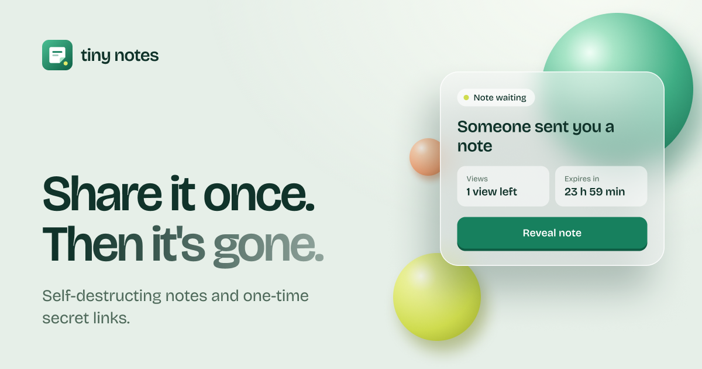
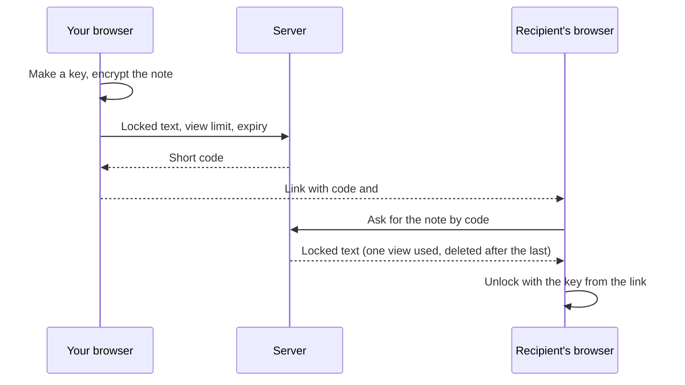

<p align="center">
  
</p>

<h1 align="center">Tiny Notes</h1>

<p align="center">End-to-end encrypted notes that delete themselves.</p>



## What it is

Tiny Notes is a small web app for sending something you don't want lying around afterwards: a password, an API key, a one-off message. You write the note, get a link, and send the link. The note deletes itself after it has been opened a set number of times or when its timer runs out, whichever comes first.

The note is encrypted in your browser before it is sent. The server stores only locked text it has no key for, so nobody on the server side can read a note: not the app, not its operators, not someone holding a copy of the database.

There are no accounts and nothing to install. It runs as one Node process. Notes are stored in [Turso](https://app.turso.tech/), a hosted SQLite database.

## How it works

1. **Write it.** Type or paste your text, choose how many times it can be opened (1 to 100) and how long it lasts (1 minute to 7 days).
2. **Your browser locks it.** A random 256-bit key is made on your device and the note is encrypted with AES-256-GCM. Only the locked text is sent.
3. **Share the link.** The link looks like `https://host/n/aB3xK9pQ#<key>`. The key sits after the `#`, a part of the address that browsers never send to any server.
4. **The recipient reveals it.** Opening the link shows how many views are left and when it expires. Pressing **Reveal note** fetches the locked text and unlocks it in their browser.
5. **It disappears.** After the last view, or at expiry, the locked note is deleted from the server.

The note and its key take different routes, and only the two ends ever hold both:



## What it does

- **End-to-end encryption.** Encryption and decryption happen in the browser. The key is never sent to, logged by, or stored on the server.
- **View and time limits.** Each note has a view count and an expiry. It is gone as soon as either runs out.
- **One view means one reader.** If two people press Reveal on a one-view note at the same moment, exactly one of them gets it.
- **Opening a link is free.** The note page only shows status. A view is used only when someone presses Reveal, so link previews in chat apps cannot burn a note.
- **Live view of what the server receives.** While you type, the page shows the actual encrypted text that would be sent.
- **Expanded view.** One button makes the note card fill the window, for writing or reading longer text.
- **Used, expired and unknown links look the same.** Nobody can probe which notes exist.
- **Search friendly, privately.** The home page is fully indexable; note pages are never indexed or cached.
- **Rate limited.** Each network can create 20 notes per 10 minutes, so one client cannot fill the disk.
- **A plain JSON API** underneath, for scripts and other clients.

Limits: plain text up to 75 KB on the site, 1 to 100 views, 1 minute to 7 days.

## Run it

```sh
npm install
cp .env.example .env   # optional: fill in Turso values, or leave empty for a local file
npm run dev      # http://localhost:3000, restarts on change
npm test
npm run build && npm start
```

| Variable | Default | Purpose |
| --- | --- | --- |
| `PORT` | `3000` | Port to listen on |
| `TURSO_DATABASE_URL` | none | Turso database address (`libsql://...`). When set, notes are stored in Turso |
| `TURSO_AUTH_TOKEN` | none | Token for that database. Keep it out of git |
| `NOTES_DB` | `data/notes.db` | Local SQLite file, used only when `TURSO_DATABASE_URL` is not set |
| `TRUST_PROXY` | `0` | Number of reverse proxies in front of the app (`1` behind nginx or a platform load balancer). **Set this in production**, or every visitor shares one rate limit |
| `ANALYTICS_PASSWORD` | none | Password for the analytics page. When unset, `/analytics` does not exist |
| `SITE_URL` | request host | Public origin without a trailing slash, e.g. `https://notes.example.com`. **Set this in production**: canonical URLs, share links, the preview image URL and the sitemap use it |

The site needs HTTPS in production (or `localhost` in development), because browsers only allow encryption on secure pages.

## Database

The app uses **[Turso](https://app.turso.tech/)**, a hosted SQLite-compatible database, through the `@libsql/client` driver.

- **Setup:** create a database at [app.turso.tech](https://app.turso.tech/), copy its URL (`libsql://...`) and create an auth token, then set them as `TURSO_DATABASE_URL` and `TURSO_AUTH_TOKEN`.
- **Tables:** `notes` holds the live, encrypted notes. `note_stats` and `counters` hold the anonymous numbers behind the analytics page. All three, and the triggers that keep the stats up to date, are created automatically the first time the app starts.
- **Local development without Turso:** leave `TURSO_DATABASE_URL` empty and the app writes to a local SQLite file (`data/notes.db`, or the path in `NOTES_DB`). The same SQL runs on both, and the tests use an in-memory database.
- **Hosting note:** because the data lives in Turso, the app server needs no disk of its own. Put the server in a region close to the database to keep requests fast.

## Project layout

One Node + Express process serves both the JSON API and the web pages. Pages are rendered on the server from template strings; there is no frontend build.

| Path | What |
| --- | --- |
| `src/server.ts`, `src/app.ts` | Entry point and Express app factory |
| `src/notes.routes.ts`, `src/notes.repo.ts` | JSON API and the database queries |
| `src/db.ts` | Opens the database (Turso or a local file) through `@libsql/client` |
| `src/pages.routes.ts`, `src/views.ts` | HTML pages, `robots.txt`, `sitemap.xml` |
| `src/analytics.ts`, `src/analytics.view.ts` | Analytics queries and the dashboard page |
| `public/crypto.js` | The encryption: AES-256-GCM via the browser's Web Crypto |
| `public/app.js` | Page behaviour: encrypts and sends a note, fetches and decrypts one, live readouts |
| `public/` (rest) | Stylesheet, fonts, logo and preview image |
| `test/` | API and page tests |
| `req.md` | The original requirement for the API |

## Pages

| Path | Purpose | Indexed |
| --- | --- | --- |
| `GET /` | Home: write a note, how it works | Yes |
| `GET /open` | Find a note from a pasted link (parsed in the browser, never sent) | No |
| `GET /n/{code}` | Note status. Never uses a view | No |

Creating and revealing go through the JSON API from `public/app.js`.

## Analytics

`/analytics` is an unlisted dashboard: nothing links to it, it is not in the sitemap or `robots.txt`, and it is never indexed or cached. It opens with a password form; the password is `ANALYTICS_PASSWORD`. The numbers are read from the database only after the password is checked, and attempts are limited to ten per client per 10 minutes. Without `ANALYTICS_PASSWORD` the page does not exist. A client that sends `Accept: application/json` with the password gets the same numbers as JSON.

It shows how many notes are created and when, how they end (read or expired unread), how long recipients take to open them, note sizes, and which expiry and view limits people choose, each with smallest, median, average and largest.

What is stored, in the `note_stats` and `counters` tables: per note, its creation time, estimated text size, chosen view limit and expiry, views used, link opens, first and last reveal times, and how it ended. No content, keys, IP addresses or other visitor details. When a note is gone, its code in the analytics row is replaced with a random value, so the numbers cannot be tied back to a link. The rows are kept up to date by database triggers, inside the same transaction as the note itself.

## API

| Method | Path | Purpose |
| --- | --- | --- |
| `POST` | `/notes` | Create a note. Body: `content`, optional `max_views` (1–100, default 1) and `expires_in` seconds (60–604800, default 86400) |
| `GET` | `/notes/{code}` | Read the content. Uses one view |
| `GET` | `/notes/{code}/meta` | Views left and timestamps. Uses nothing |

Errors are JSON: `{ "error": "<code>", "message": "<text>" }`.

Rate limits, per client IP: 20 new notes per 10 minutes, and 120 note requests per minute overall. Over the limit the API answers `429` with `rate_limited` and a `Retry-After` header in seconds. A refused read never uses a view.

The API stores whatever string it is given. The website always sends encrypted text; API clients that want the same protection must encrypt before calling it, and `public/crypto.js` is the reference.

## Encryption details

- The browser generates a random 256-bit key when the page opens.
- On submit it encrypts the note with AES-256-GCM, using a fresh random IV each time, and posts `base64url(iv + ciphertext + tag)` as `content`.
- The key goes after the `#` in the share link. Browsers do not send the fragment in requests, so it never reaches the server, its logs or the database.
- The recipient's browser fetches the ciphertext and decrypts it with the key from the link.

What follows from that:

- A lost link cannot be recovered: nobody else ever had the key.
- The site needs JavaScript.
- The page's own code does the encrypting, so users trust the server to deliver honest code. A strict Content-Security-Policy (`default-src 'self'`) rules out inline and third-party scripts.

## SEO

- The home page is fully rendered HTML with a title, meta description, canonical URL, Open Graph and Twitter tags, and `WebApplication` structured data.
- `robots.txt` and `sitemap.xml` list the home page only.
- Every other page sends `X-Robots-Tag: noindex, nofollow` and `Cache-Control: no-store`, so note links never reach search results.
- The social preview image is `public/og.png` (1200×630) and the logo is `public/favicon.svg`.

## Implementation notes

- **Atomic reads**: one `UPDATE ... WHERE views_left > 0 AND expires_at > ? RETURNING`, plus the delete, sent as a single transaction in one round trip (`src/notes.repo.ts`).
- **Storage**: Turso (hosted SQLite) in production, a local SQLite file otherwise; the same SQL runs on both. Expired rows are swept every 10 minutes.
- **Size limit**: a JSON request body is capped at 102,400 bytes. Encryption and base64 add about a third, so the site limits a note to 75 KB of text.
- **Rate limiting**: fixed-window counters per client IP, held in memory (`src/rate-limit.ts`). They reset on restart and are per process, so running several instances would need a shared store.
- **Logs**: the request log records the route pattern, never the URL or body, so neither codes nor content are logged.
- **Templates**: `src/views.ts` builds pages from template strings; every dynamic value is HTML-escaped.
- **Design**: the logo, preview image and page designs live in the Figma file "Tiny Notes — Brand".
